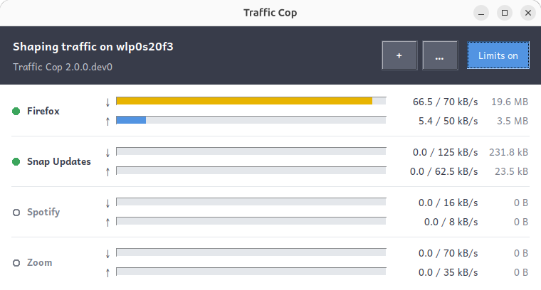

# Traffic Cop
Traffic Cop limits how fast each app may download and upload, and shows how
much each one is using right now. It's meant for slow or metered
connections: keep a video call usable while updates download, or stop one
app from using up the whole connection or your data bundle.



## Features
- Per-app download and upload limits, e.g. Firefox at 70 kB/s down and
  50 kB/s up. Every process of an app shares its limit.
- Live rates and totals for each app, including UDP traffic (video calls).
  Apps can also be listed without a limit, just to watch them.
- Pause and resume all limits at once. Traffic is still measured while paused.
- Follows the internet connection automatically: Wi-Fi, Ethernet, or a VPN
  when one is connected.
- A window for everyday use and a command (`wasta-traffic-cop`) for the
  terminal.
- English and French.

## Installing
Traffic Cop is a snap, so it needs a Linux distribution with snapd. (Linux
Mint blocks snapd by default; it has to be enabled first.)
```bash
sudo snap install wasta-traffic-cop
```
The background service needs a few permissions that snaps don't get
automatically. Connect them once, then restart the service:
```bash
sudo snap connect wasta-traffic-cop:network-control
sudo snap connect wasta-traffic-cop:firewall-control
sudo snap connect wasta-traffic-cop:system-observe
sudo snap connect wasta-traffic-cop:network-observe
sudo snap restart wasta-traffic-cop.daemon
```

After a fresh install the limits are **paused**: nothing is slowed down
until you turn them on. After that, Traffic Cop remembers whether it was
paused or running, including across reboots.

## Using it
Open **Traffic Cop** from the menu. Each app has a bar for download (↓) and
upload (↑) showing how much of its limit it's using. A bar turns yellow when
the app is at its limit, i.e. being held back. While paused, the bars are
grey.

The same things from a terminal:
```bash
wasta-traffic-cop status          # running or paused, and each app's limits
wasta-traffic-cop rates -w        # live rates and totals (Ctrl+C to stop)
wasta-traffic-cop pause           # turn the limits off (still measuring)
wasta-traffic-cop resume          # turn them back on
wasta-traffic-cop config show     # print the settings
wasta-traffic-cop config set FILE # check, apply and save new settings
```
Anyone can watch. Changing anything (pausing, resuming, editing apps or
limits) needs an administrator account: root, or a member of the `sudo`,
`admin` or `wheel` group.

## Choosing apps and limits
Add, edit and remove apps in the Traffic Cop window. Each app has a name, an
optional download limit, an optional upload limit, and one or more ways to
recognise it:

| key | matches | example |
|---|---|---|
| `snap` | a snap package | `firefox` |
| `flatpak` | a flatpak app ID | `com.spotify.Client` |
| `exe` | the program's full path | `/opt/zoom/zoom` |
| `name` | the process name (regular expression) | `spotify` |
| `cmdline` | the whole command line (regular expression) | `.*/usr/lib/firefox/firefox.*` |
| `scope` | the app's systemd scope (regular expression) | `app-gnome-Zoom-[0-9]+\.scope` |
| `service` | a system service | `snapd.service` (snap updates) |

The settings can also be edited as a file and loaded with
`wasta-traffic-cop config set`, which checks them before applying. For
example:
```yaml
version: 2
apps:
  "Zoom":
    download: 70kbps
    upload: 35kbps
    match:
      - snap: zoom-client
      - exe: /opt/zoom/zoom
```
In the file, limits use `tc` units, and *bit* and *bps* differ: `kbit` is
kilobits per second, `kbps` is kilo**bytes** per second, so `100kbps` is
the same as `800kbit`. The default settings, with more explanation, are in
[traffic-cop.yaml.default](src/trafficcop/common/traffic-cop.yaml.default).
The service keeps its copy in `/var/snap/wasta-traffic-cop/current/`.

## What can be limited
Traffic Cop recognises an app by the *systemd unit* the desktop starts it
in, so that all of an app's processes, and every kind of traffic, are
counted together. That works for:
- **snap and flatpak apps**, on any desktop;
- **system services** named with `service`, such as snap updates;
- **other apps launched from the menu on GNOME** (and probably KDE), which
  gives each app its own unit.

It doesn't work as well for:
- **Apps started from a terminal**, which share the terminal's unit (in
  GNOME Terminal, the tab's).
- **Desktops that don't give apps their own unit** (believed to include
  Cinnamon, Xfce and MATE; not yet tested). There, other apps can't be told
  apart, so only snap, flatpak and service apps can be limited.
- **Apps whose launcher starts the real program and exits**, which escape
  their unit on GNOME. Zoom's `.deb` is one: its meetings can't be limited.
  Matching the program with `exe` or `cmdline` doesn't get around this:
  matching only chooses which unit to limit, and the escaped program ends
  up in GNOME Shell's own unit, which Traffic Cop leaves alone. Use the snap
  or flatpak version of such apps instead.

Tested on Ubuntu 26.04 with GNOME. Requires systemd with cgroup v2 (Ubuntu
21.10 or later).

## Good to know
- **Download limits work by dropping data that arrives too fast**, which
  makes the sender slow down. The dropped data has still crossed your
  connection, so it counts toward the limit. As a result, an app at its
  download limit receives somewhat less than the limit as useful data.
- **Rates include packet headers**, so totals can differ a little from what
  your provider reports.
- **Rates are smoothed** over a few seconds. Shaped traffic comes in bursts,
  so second-by-second values jump around even while the average holds at
  the limit.
- Very low limits slow an app down a lot but don't block it completely.

## Logs
```bash
sudo snap logs -f wasta-traffic-cop.daemon       # follow the service's log
journalctl -u snap.wasta-traffic-cop.daemon       # the full log
```

## How it works
A background service (`traffic-copd`, running as root) does all the work;
the window and the `wasta-traffic-cop` command only talk to it, so they
never need root themselves.
- It finds each app's systemd unit and adds **nftables** rules that mark
  the app's packets.
- On the interface connected to the internet, **tc** sends each limited
  app's upload to its own **CAKE** queue at the app's rate. Downloads are
  redirected through an `ifb` device and limited the same way.
- Counters on the same rules give the live rates.

## Development
```bash
sudo apt install python3-nftables python3-tk
python3 -m venv --system-site-packages .venv && . .venv/bin/activate
pip install -e '.[dev]'
pytest -m "not integration"     # unit tests
pytest -m integration           # real nft/tc in a network namespace; no sudo
snapcraft pack                  # build the snap (uses LXD)
```
More notes for developers are in [CLAUDE.md](CLAUDE.md).

## About
Traffic Cop 1.x was built on the [TrafficToll](https://github.com/cryzed/TrafficToll)
Python package by [cryzed](https://github.com/cryzed), with
[nethogs](https://github.com/raboof/nethogs) for the live rates. Version 2
is a rewrite that recognises apps by their systemd unit instead of their
network ports, which is more reliable and also measures UDP. Settings from
1.x can't be read by 2.x; set your apps up again in the new window.

Licensed under the [GNU GPL v3](LICENSE). Please report problems in the
[issue tracker](https://github.com/wasta-linux/traffic-cop/issues).

*This app uses an icon based on the "traffic-police" icon created by
[Freepik](https://www.flaticon.com/authors/freepik) and found at
https://www.flaticon.com/.*
